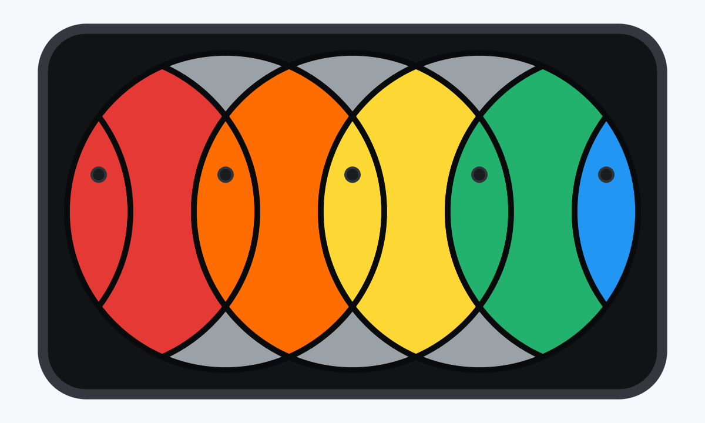
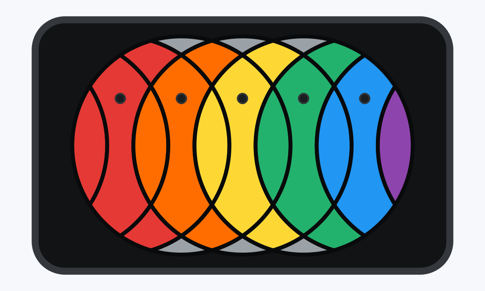
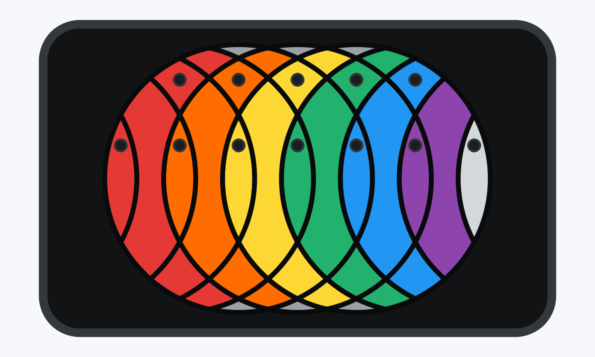
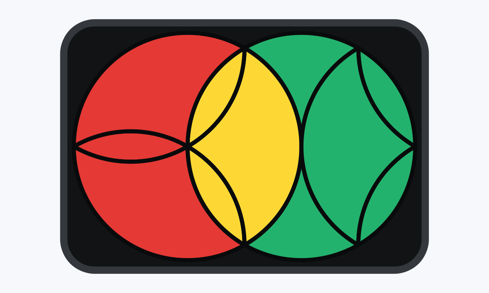
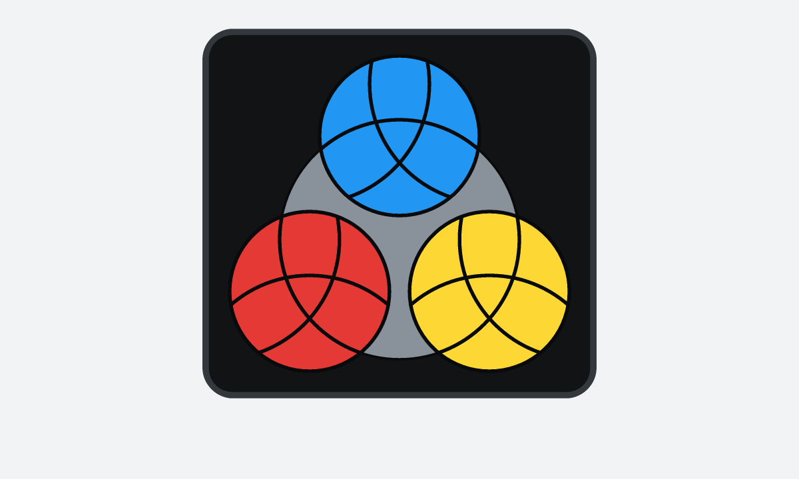
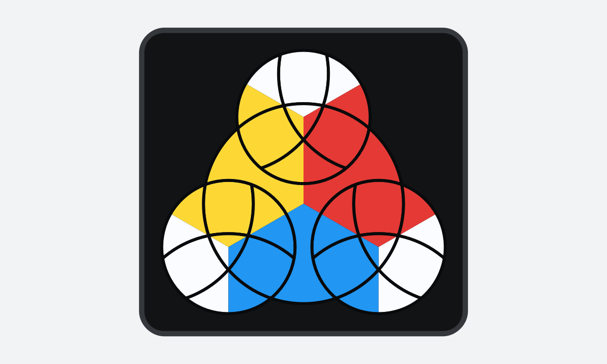
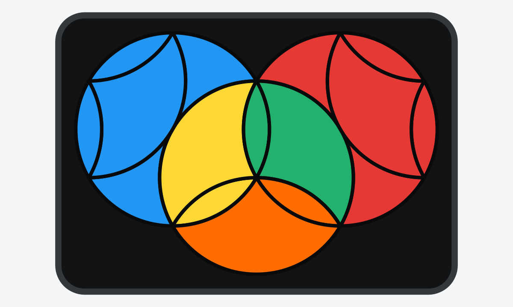
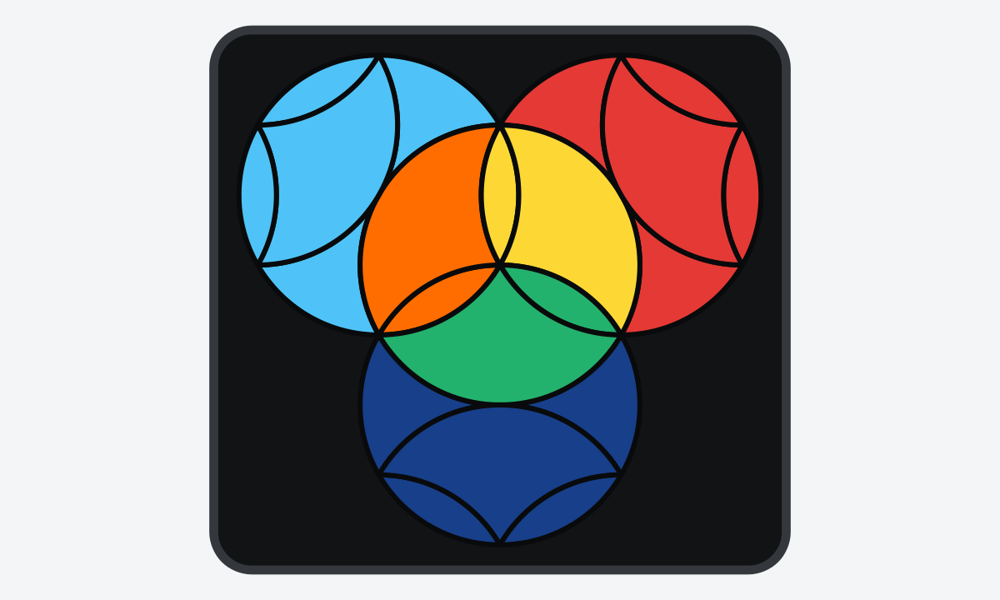
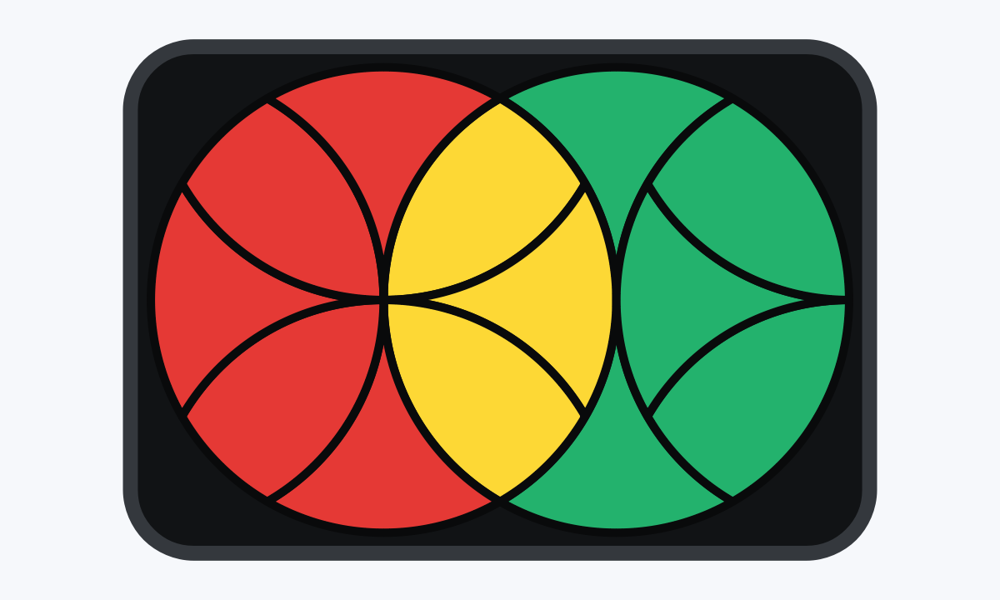
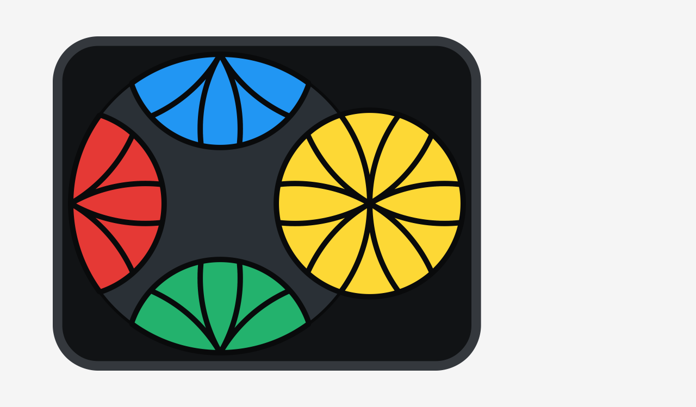

# Puzzle World

Puzzle World is a desktop application for playing a growing collection of flat mechanical puzzles. Each puzzle family has its own rules and renderer, while the window, history, saved games, controls, and animation framework are shared.

## Puzzles

### Looper

Three overlapping circles containing lens and vertical elements. A turn rotates the five elements inside one circle by 180 degrees.



### Super Looper

A Looper modification with deeper cuts and more elements, adding oriented vertical and paired diamond pieces.



### Hyper Looper

A further modification with deeper cuts and even more elements: oriented lenses and large paired diamonds, unoriented vertical and small paired diamonds, and a light-gray final lens.



### TriLotica

Two circles one radius apart: the left disk cycles three lenses and three curved triangles by 120 degrees, while the right disk swaps two three-piece sets with a half-turn.



### TriLotica v2

TriLotica with deeper cuts that add a central triangle and a cycle of three large
truncated lenses to the left disk; turn steps remain 120 degrees on the left and
180 degrees on the right.


### Trinita

Four circles turn by 120 degrees. Assemble seven equal colours in each small disk;
the three completed colour groups may occupy any disks.



### Trinita v2

Trinita's same four-circle mechanism with multicolour pieces. Curved triangles,
the three central triangles, and the central cross carry a 120-degree orientation;
the reference assembly and its two whole-board rotations are valid finishes.



### Double TriLotica and Triple TriLotica

TriLotica variants with two or three right-hand disks around the same central
120-degree disk. The centre turns by 120 degrees; every outer disk turns by 180 degrees.

#### Double TriLotica



#### Triple TriLotica



### Lotica

Two circles one radius apart: the left disk cycles four lenses and four curved triangles by 90 degrees, while the right disk swaps two lens-and-triangle sets with a half-turn.



### Lemons

A puzzle with a large circle and a small circle. The large disk turns by 90 degrees,
the small disk by 60 degrees. Assemble yellow in the small disk and form the red,
green, and blue groups in any order around the large disk.



## Install

```text
python -m pip install -r requirements.txt
```

## Run

```text
python -m game
```

## Test

```text
pytest
```

## Main modes

- **Free play** starts with a solved board. Moves are not counted and solving the puzzle does not end the session. Use this mode to study the mechanism and test move sequences.
- **Solving** starts after a reproducible scramble. Manual moves and redo increase the move counter, undo decreases it, and returning to the solved state completes the game.

## Repository structure

```text
docs/                       Design rules, puzzle-extension guide, and save format
game/
├── domain/                 Shared immutable domain values and rule protocols
├── puzzles/
│   ├── looper/             Looper model and its independent Qt renderer
│   ├── super_looper/       Super Looper model and its independent Qt renderer
│   ├── hyper_looper/       Hyper Looper model and its independent Qt renderer
│   ├── trilotica/          TriLotica model and its independent Qt renderer
│   ├── trilotica_v2/       TriLotica v2 model and its independent Qt renderer
│   ├── trinita/            Trinita model and its independent Qt renderer
│   ├── trinita_v2/         Oriented multicolour Trinita model and renderer
│   ├── lotica/             Lotica model and its independent Qt renderer
│   ├── lemons/             Lemons model and its independent Qt renderer
│   └── registry.py         Implemented and planned puzzle registry
├── application/            Sessions, game modes, history, and scrambles
├── input/                  Input-to-command translation without puzzle rules
├── persistence/            JSON saves, board codecs, and application settings
└── ui/                     Main window, board widget, camera, and animation
tests/                      Domain, application, persistence, input, and UI tests
requirements.txt            Runtime and test dependencies
pytest.ini                  Test discovery and repository-local test settings
```

New puzzle families belong in `game/puzzles/<puzzle_id>/`. Each puzzle owns its model and renderer while the session, history, save envelope, and main window remain puzzle-independent.

## Code style

- Use a maximum line length of 110 characters.
- Wrap a line only when it would exceed 110 characters; do not add shorter cosmetic wraps.
- Leave two empty lines between function definitions and between method definitions.
- Keep filenames, identifiers, comments, and documentation in English.

## Controls

- Left click a highlighted circle to turn it counter-clockwise by 180 degrees.
- Right click a highlighted circle to turn it clockwise. Looper is a half-turn puzzle, so both directions currently have the same logical result.
- The board automatically fits the window and resizes with it.
- `Q`, `W`, and `E` turn circles 1, 2, and 3 counter-clockwise; hold `Shift` to turn the corresponding circle clockwise.
- `Ctrl+Z` / `Ctrl+Y` undo and redo; `Ctrl+Shift+Z` is an alternate redo shortcut.
- `Ctrl+O` opens a JSON save and `Ctrl+S` saves it.
- `Escape` clears transient selection or messages and never exits the application.

See [docs/DESIGN.md](docs/DESIGN.md) for rules and architecture,
[docs/ADDING_PUZZLES.md](docs/ADDING_PUZZLES.md) for the implementation guide for
new puzzle families, and [docs/SAVE_FORMAT.md](docs/SAVE_FORMAT.md) for the save format.
